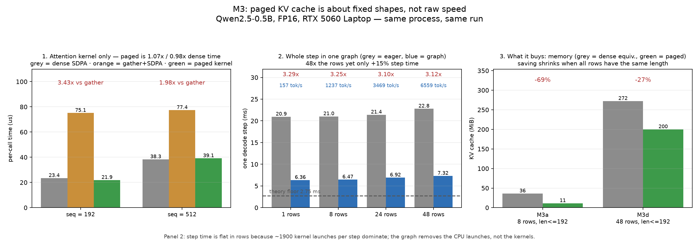

# 项目⑤：LLM serving —— 延迟到底去哪了，每条优化又买到什么

> ← [返回主页](../README.md)　·　**项目⑤ LLM Serving** ｜ [01](../01-resnet50-trt/README.md) · [02](../02-yolov8-trt/README.md) · [03](../03-gpt-trt/README.md) · [04](../04-bev-ops/README.md) · [05](../05-llm-serving/README.md)

> 前四个项目都在问同一个问题：**"这个算子/kernel 该怎么做，或者该不该做"**。
> 这个项目故意离开 TensorRT，因为它要问的是另外三件事：**一次前向的固定成本、缓存怎么组织、请求怎么排队**。
> 结论先放这里：在 0.5B 这个尺度上，**瓶颈不在内核选择，而在每步 17–26 ms 的 Python 派发**——
> 所以能不能上图（CUDA Graph）、能不能摊销步数，比把 attention 写快重要 10 倍以上。

**环境**：Qwen2.5-0.5B-Instruct（FP16，942 MB）· RTX 5060 Laptop（sm_120，26 SM，8 GB）· Ubuntu 26.04 (WSL2) · torch 2.11.0+cu128 · transformers 5.24.1 · Triton 3.6.0
**测量纪律**：所有数字都是**同一进程、同一次运行**内的配对测量；跨运行漂移在这台笔记本上见过 11%–31%，所以不跨脚本引用绝对值。



---

## 里程碑：每一步各自买到多少

| 里程碑 | 做了什么 | 关键数字 | 结论 |
|---|---|---|---|
| **M0** 基线 | 手写 decode 循环（不用 `generate()`），逐步计时 | 17.4 ms/步、55.6 tok/s | 942 MB ÷ 17.4 ms = **54 GB/s**，只有峰值 384 的 14% → **不是带宽瓶颈** |
| **M0b–M0c** 诊断 | launch 单价、GEMM 带宽、算子计数 | 裸 launch **8.99 µs**；一次 decode **1851 个算子**、9.21 µs/个；其中 **47% 是 `view`/`transpose` 这种零计算算子**，只有 9% 是矩阵乘 | `1851 × 9.21 = 17.05 ms ≈ ITL 17.04` → **Python 派发就是全部瓶颈**，GPU 只用了 2.76 ms |
| **M0d–M0e** 三个杠杆 | `torch.compile`（只融合）/ 手动 CUDA Graph | compile **7.33 ms（2.40×）**；手写图 **5.27 ms（3.71×）**，token 逐位一致 | 融合省**算子个数**（1851→约 840），Graph 省**CPU launch** |
| **M0f** 图 + batch | 一张图跑 1/8/24/48/128 行 | 步时 5.29→8.02 ms，加速比 3.7×→2.6×（下降是 GPU 地板抬起来了） | 模型 `ITL(B) = 2.2 + (942 + 7.875B)/341.8` ms，逐格残差 <3% |
| **M1** 静态 batch | 等长请求合批 | batch 8 → 416 tok/s，batch 128 → **3267 tok/s（58.8×）**；ITL 几乎不变 | 加 batch 到显存用尽（74%）都**不会**变成带宽问题 |
| **M2a** 变长请求 | serial / pad_max / bucket | pad_max **5.09×**、bucket 4.40×（**反而低 14%**） | **decode 阶段"步数"比"填充量"贵得多**（85 步 vs 31 步 → 80 GB vs 29 GB 权重读） |
| **M2b** 连续批处理 | 逐行 mask（无填充）+ 单张图 + 批量 prefill | 步数 **−25%**、槽位利用率 61→82%，吞吐只 **+5%** | 补位是"一次一条"的 prefill，把省下的步数又还回去了（[报告](m2b_writeup.md)） |
| **M3** 分页 KV | 块表 + Triton 分页 attention + 整步上图 | 显存 **36.0 → 11.2 MiB（3.2×）**；kernel 比 gather 快 **3.44×**、与连续 KV **打平（1.07×/0.98×）**；整步图 **3.1–3.3×**、48 行 **6559 tok/s** | **分页不是为了更快，是为了让形状固定成为可能**，形状固定才是那 3 倍（[报告](m3_writeup.md)） |
| **M4** chunked prefill | 抢占式切块 + `q_len>1` 分页 kernel | 尖峰 **490 → 262 ms（−47%）**，中位数 +10%，新请求 TTFT 0→7 步；1024 token 切 15 块 **59.7 → 430.5 ms** | 切块代价 **99.8% 在"每块一次完整前向"**，attention kernel 只占 0.43 ms（[报告](m4_writeup.md)） |
| **M5** prefix caching | 块级链式哈希 + refcount + 只登记满块 | 命中 TTFT **94 → 31 ms（3.0×）**，8 条请求总 prefill **2.44×**，token 全一致 | 命中后的 30 ms **就是一次前向的地板**，不是残余计算（[报告](m5_writeup.md)） |

---

## 三条可迁移的判据

### ① 先量地板，再谈优化

这台机器上一次 eager 前向的固定成本是 **17–26 ms**（约 1850 个算子 × 9.2 µs），与 token 数几乎无关。所以所有"减少步数"的优化都赢在这上面：

- 静态 batch（步数不变、每步带更多 token）→ **58.8×**
- CUDA Graph（步数不变、每步只 1 次 launch）→ **3.7×**
- prefix caching（少做 512 token 的活）→ **3.0×**

而"把 kernel 写更快"在 attention 这种单项上最多 **3.44×**，端到端只占 **0.1%–1%**。

> 判据：**动手写 kernel 之前，先算出它占端到端多少。** 占比 <5% 就该停手——这和项目④里"写了 plugin 但判定不该用"是同一条判据的第二次出现。

### ② 形状固定是一切的钥匙

- dense cache 的 `level` 每步 +1，`attention_mask` 长度每步变 → **永远捕获不了**；
- 分页之后 `block_table` / `seq` / KV 池形状全部恒定 → 一步一张图，**3.1–3.3×**；
- 但形状固定只是**必要条件**：`StaticCache` 的 `cumulative_length` 是原地写，cache 又是 `forward()` 的输入 → `skipping cudagraphs due to mutated inputs`。

> 判据：**能不能上图 = 形状恒定 ∧ 不原地写图的输入。**

### ③ 验收工具要先被验收

这一轮里"**我的验收工具错了**"出现了 **6 次**，每次的表现都是"代码看起来有 bug"：

| # | 症状 | 真因 |
|---|---|---|
| 1 | 分页 prefill 对拍 rel = 2.46 | `lim[:, None]` 把一维变三维，mask 广播成错误形状 |
| 2 | decode token 全不一致（差 1.9e+01） | 参考的第 0 步来自 prefill，我的第 0 步来自喂进 token 1 之后（**差一格**） |
| 3 | chunked prefill "全部不一致" | 同上，`ref[:,0]` vs `toks[:,0]` 差一格 |
| 4 | 分页 attention "快 11.13×" | 基线带 mask → SDPA 退回 math 后端（489 µs vs 23 µs）+ `repeat_interleave` 把 KV 物化 7 倍 |
| 5 | `mark_static_address: 0 个张量` | `StaticCache` 不再暴露 `.layers`，24 个标记**一个都没执行**（静默失效） |
| 6 | prefix cache "块池耗尽" | `block_hashes` 用 `ids.shape[0]` 当长度，(1, L) 张量算出 **0 块** |

> 判据：**任何"一致 / 更快 / 有效"的结论之前，先做一次"故意弄错"的对照**——换一套填充文本看结果变不变、换一个基线看倍数缩不缩水、打印执行次数看代码真的跑了没有。

---

## 已知限制（必须一起说）

1. **不是可用的 serving 系统**：没有 HTTP server、没有采样（只有 greedy）、没有 KV 量化、没有投机解码、没有多模型。
2. **没有多卡**：单卡 8 GB，TP/PP 完全没碰。
3. **block table 是静态预分配**（每行独占一段连续块），不是真正的按需分配器；M5 的 bank 也没有淘汰策略。
4. **绝对值不能当产品数字**：本机 eager 路径被 Python 开销主导，`tok/s` 只适合同一次运行内的相对比较。
5. **"为什么慢"多数只有分解、没有归因**：WSL2 上 `ncu` / `nsys` / `compute-sanitizer` 全部不可用（CUPTI 初始化失败），像"ITL 从 17.9 涨到 20.2 ms"只能给分解，不能给 kernel 级证据。
6. **M5 的收益是最好的 workload**：8 条请求共享 512 token 完全相同前缀，真实流量的命中率没测。

---

## 复现

```bash
pip install torch transformers triton
# 模型权重要自己下（HF 或 ModelScope），代码里是 local_files_only=True

python m0_baseline.py                      # 基线：17.4 ms/步、55.6 tok/s
python m0c_count_ops.py                    # 1851 个算子（不需要 CUPTI）
python m0e_manual_graph.py                 # 手动 CUDA Graph 3.71×
python m1_static_batch.py --batches 1,8,32,128
bash   run_m2b.sh                          # 连续批处理四组配置 + 图
python m3d_graph_paged.py --rows 1,8,24,48 # 分页 + 整步上图
bash   run_m4c.sh                          # chunked prefill 端到端
bash   run_m5a.sh                          # prefix caching
```

| 文件 | 作用 |
|---|---|
| `m0_baseline.py` / `m0b_diagnose.py` / `m0c_count_ops.py` | 基线、launch 单价、算子计数 |
| `m0d_static_cache.py` / `m0e_manual_graph.py` / `m0f_graph_batch.py` | 三个杠杆与 `ITL(B)` 模型 |
| `m1_static_batch.py` / `m2a_ragged.py` / `m2b_continuous.py` | batch 与调度策略 |
| `m3a_paged.py` / `m3b_paged_attn.py` / `m3c_qwen_paged.py` / `m3d_graph_paged.py` | 分页分配器、Triton kernel、接进模型、上图 |
| `m4a_mixed.py` / `m4b_paged_prefill.py` / `m4c_qwen_chunk.py` | chunked prefill 三段 |
| `m5a_prefix_cache.py` | 块级 prefix cache |
| `plot_m*.py` / `run_m*.sh` | 出图与一键复现 |
