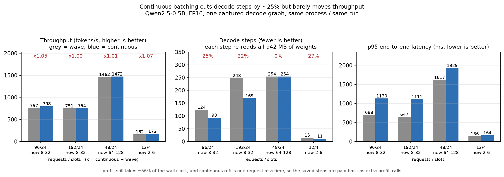

# M2：连续批处理实测 —— 解码步数少了 25%，吞吐只多 5%

> 环境：RTX 5060 Laptop（26 SM，8 GB）· WSL2 Ubuntu 26.04 · torch 2.11.0+cu128 · transformers 5.24.1 · Qwen2.5-0.5B-Instruct FP16
> 代码：`m2b_continuous.py`（约 430 行）· 图：`m2b_summary.png` · 原始数据见正文表格
> 全部数字在**同一进程、同一次运行**内测得（wave 与 continuous 交替跑，共享同一份权重与同一张 capture 图）。

## TL;DR

1. 连续批处理把**解码步数砍掉 25–32%**、把**槽位利用率从 61% 提到 82–90%**，但**端到端吞吐只快 0.4–7%**。
2. 原因不在 kernel，在**事件次数**：每个解码步要重读全部 942 MB 权重（≈9.5 ms），省下的步数确实值 600 ms；但补位是"一次一两条"，多出来的 prefill 调用把这 600 ms 又还回去了 578 ms。
3. 决定性的实验：**填充必须靠 `attention_mask` 压掉**（换一套填充文本，logits 差 6.75 vs 0.0000）。压掉之后发现**根本不需要填充** —— 一行只 attend 自己的 mask，中间留空洞即可。
4. 单请求延迟没变差（p50 反而略降），**尾延迟显著变差**（p95 +19% ~ +72%）：补位那次 prefill 是停等的。
5. 这个系统当前的第一瓶颈不是调度，是**prefill 的固定开销**（每次 eager prefill 约 26 ms，而 130 token 的真实计算只要 1.7 ms）。

---

## 1. 要回答的问题

M1 测完静态 batching 后留下一个明确的问题：**batch 一开，槽位就在空转**（24 槽里平均只有 14.7 个在跑），而每个空转的槽位都是白付的显存和一次 KV 读。

于是 M2 的问题是：**动态补位（continuous batching）能把这个浪费换回多少吞吐？**

要回答它，必须先把三件事做对，否则测出来的数只是"调度器跑得多快"，不是"调度策略值多少"：

- **必须用 CUDA Graph**：eager 的每步 19.5 ms 里 17 ms 是 Python 开销，padding 多读的那点 KV 会被完全淹没 —— 用 eager 测，任何调度策略都会显示成"一样快"。
- **必须能对拍**：空转的槽位要有内容（否则形状不固定），而填进去的内容不能改变输出。
- **必须区分口径**：`tok/s` 里含不含 TTFT、墙钟里含不含捕获与清理，差一个就是两种结论。

## 2. 实现（真的做了什么）

### 2.1 一张图 + 两个静态缓冲

一次 decode 步的全部变化量被压成两样东西：

```python
engine.ids   # (slots, 1)  long  —— 每行这一步要吃什么 token
engine.mask  # (slots, cap) bool —— 每行到哪一步为止可见
engine.pos   # (slots, 1)  long  —— 每行自己的绝对位置（喂 RoPE）
```

三者形状永远不变，每步只做原地写（`mask[slot, level] = 1`、`pos[slot, 0] = plen + gen - 1`），然后 `graph.replay()`。所以**一次 replay 只付一次 launch**，CPU 侧不参与。

这也解释了为什么必须自写路径：transformers 5.24.1 的 `StaticLayer.update` 用**一个标量** `cumulative_length` 决定写入位置，batch 内所有行共享 —— 逐行不同位置它表达不了。

### 2.2 填充被证明不是必需品

先问一个之前没验过的问题：**左填充到底会不会改变输出？**

用最狠的判据 —— 同一长度、**只换填充文本**，输出必须一字不变：

| 做法 | 换填充文本后 logits 的最大绝对差 |
|---|---|
| 不传 mask（填充会被 attend） | **6.7480** |
| 传 `attention_mask` + 逐行 `position_ids` | **0.0000e+00** |

结论有两层：

1. 填充**必须**压掉，否则"只验证没填充的行"是在躲问题；
2. 压掉之后，填充本身就多余了 —— 一行只 attend 自己 `mask=1` 的位置，prompt 直接放 `0..plen-1`，**中间与尾部留空洞**。

省下的是**显存**和 **prefill 的 token 数**；KV 空洞仍会被 attention 扫过（`QK^T` 照算），所以计算量不减。这一点在下面的"空洞 token"一列里如实记录。

### 2.3 批量 prefill

第一条实现是"补一条、prefill 一条"，结果被固定开销吃掉了：eager prefill 每条约 **26 ms**，而 130 token 的真实计算只要 **1.7 ms**。

改成**一批一次 forward**（`ids (k, L)`、`pmask (k, cap)`、`ppos (k, L)`，L = 批内最长 prompt），再逐行把 `[:plen]` 的 KV 拷进主 cache：

| 配置 | 逐条 prefill | 批量 prefill |
|---|---|---|
| 12 请求 / 4 槽 | 487.5 ms | **297.0 ms** |
| 96 请求 / 24 槽 | 3883.4 ms | **2568.9 ms** |

## 3. 正确性

`--verify` 模式下，每个生成的 token 都回读主机，与该请求"不填充、不分批、batch=1 的 eager 参考"逐位比较：

| 配置 | wave | continuous |
|---|---|---|
| 12 请求 / 4 槽 | 12/12 逐位一致 | 12/12 逐位一致 |
| 96 请求 / 24 槽 | 96/96 | 96/96 |

这是**行为级**判据，不是数值容差：不同行之间只要有任何互相污染，argmax 迟早会翻。

## 4. 结果



### 4.1 总表（四组配置，每格都是一次独立进程内的 wave → continuous 配对）

| 配置 | 模式 | 墙钟 ms | tok/s | 相对 | 槽位利用 | 解码步数 | prefill ms | 空洞 token |
|---|---|---|---|---|---|---|---|---|
| 96 请求 / 24 槽<br>prompt 48–256，new 8–32 | wave | 2536.4 | 757.0 | 1.00× | 61.3% | 124 | 1358.8 | 8256 |
| | continuous | **2405.1** | **798.3** | **1.05×** | **81.7%** | **93** | 1451.3 | 10801 |
| 192 请求 / 24 槽<br>同上 | wave | 5115.2 | 750.7 | 1.00× | 61.3% | 248 | 2688.1 | 16512 |
| | continuous | 5093.0 | **754.0** | **1.00×** | **89.9%** | **169** | 3265.8 | 28852 |
| 48 请求 / 24 槽<br>new 64–128（长输出） | wave | 3151.7 | 1462.0 | 1.00× | 74.8% | 254 | 742.3 | 4128 |
| | continuous | 3129.8 | 1472.3 | **1.01×** | 74.8% | **254** | 711.0 | 6405 |
| 12 请求 / 4 槽<br>prompt 32–128，new 2–6 | wave | 296.3 | 162.0 | 1.00× | 60.0% | 15 | 184.1 | 528 |
| | continuous | 277.0 | **173.3** | **1.07×** | **81.8%** | **11** | 189.9 | 558 |

### 4.2 尾延迟：单请求变好，尾延迟变差

| 配置 | wave p50 / p95 | continuous p50 / p95 |
|---|---|---|
| 96 / 24（短） | 545.3 / 697.9 | **497.3** / **1129.5** |
| 192 / 24（短） | 558.2 / 646.8 | **544.9** / **1110.5** |
| 48 / 24（长） | 1304.1 / 1616.5 | **1280.3** / **1929.4** |
| 12 / 4（小） | 76.2 / 136.3 | **72.3** / **164.4** |

p50 全部下降（补位让短请求早结束），p95 全部上升 19–72%。原因很具体：**补位那一刻要把 prefill 做完才能继续 decode**，整条流水线停等，被卡住的请求的端到端时间就多了一整个 prefill。

## 5. 为什么吞吐只涨 5%：把墙钟拆开

`墙钟 = prefill 总时间 + Σ(每步解码时间)`，所以每一组都能精确对账：

| 配置 | 模式 | 步数 | 解码 ms/步 | 解码总 ms | prefill ms | 墙钟 ms |
|---|---|---|---|---|---|---|
| 96/24 | wave | 124 | 9.50 | 1177.6 | 1358.8 | 2536.4 |
| | continuous | 93 | 10.25 | 953.8 | 1451.3 | 2405.1 |
| | **Δ** | **−31** | +0.75 | **−223.8** | **+92.5** | **−131.3** |
| 192/24 | wave | 248 | 9.79 | 2427.1 | 2688.1 | 5115.2 |
| | continuous | 169 | 10.81 | 1827.2 | 3265.8 | 5093.0 |
| | **Δ** | **−79** | +1.02 | **−599.9** | **+577.7** | **−22.1** |
| 12/4 | wave | 15 | 7.48 | 112.2 | 184.1 | 296.3 |
| | continuous | 11 | 7.92 | 87.1 | 189.9 | 277.0 |
| | **Δ** | **−4** | +0.44 | −25.1 | +5.8 | −19.3 |

**192 请求那行是最干净的证据**：连续模式真的省了 **600 ms 的解码时间**（少跑 79 步），但这些时间以 **578 ms 的 prefill** 的形式还了回去，净收益只剩 **22 ms**。

为什么会还回去：

- wave 模式 8 波 → **8 次**批量 prefill；
- continuous 模式槽位利用率到 90% 之后，**空出来的槽位是零星的**（一次一两条），于是补位变成一百多次小 prefill；
- 每次 prefill 的固定开销不随行数缩小（Python dispatch + kernel launch，单次约 26 ms），小批量 prefill 的单位成本因此高一个数量级。

另一条副产品：**每步解码也变贵了**（9.79 → 10.81 ms）。因为水位 `level` 随总步数单调上涨，越到后面每一行都要读更长的 KV —— 这是"静态槽位"的税，后面 M3 的动机就在这里。

### 5.1 长输出的那组为什么是 0%

48 请求 / 24 槽、输出 64–128：**wave 和 continuous 的步数完全相同（254）**。

因为 24 槽装 24 条，两波就装完了；而一波里只要有一条 128 token 的请求，整波就要跑 128 步。两波 = 2×128 ≈ 254。补位能补进来，但补进来的请求最短也要跑 64 步，**压不过"最长那条"的下界**。

这说明连续批处理的收益不是恒定的，它取决于三个量的比例：**请求数 / 槽位数**（决定波数）、**输出长度分布**（决定每波的下界）、**单次 prefill 的固定开销**。这台机器上第三个量极大，把前两个量的收益吃掉了。

## 6. 三个结论

1. **连续批处理在这台机器上不是吞吐杠杆，是尾延迟杠杆（负向的）。** 它把平均排队时间打散，代价是把尾延迟拉长；在"per-call 开销 >> per-token 开销"的尺度上，它换不出吞吐。
2. **"减少步数"和"减少调用次数"是两个方向的目标**，wave 是后者最优、continuous 是前者最优。当前的赢家是"少调用" —— 因为一次调用 26 ms，一步解码 9.5 ms。
3. **要吃到连续批处理的收益，必须先消掉 prefill 的停等**：把 prefill 切成块（chunked prefill）塞进 decode 的间隙，或者让 prefill 也能被 graph/融合加速。这是 M4 的题目，不是 M2 能回答的。

## 7. 已知限制（诚实清单）

- **没有 attention 计算量的节省**：空洞仍被 `QK^T` 扫过。所以"省 token"只在显存和 prefill 上成立。
- **空洞随总步数增长**：192 请求那组空洞从 16512 涨到 28852（+75%），因为水位单调上涨。这是静态槽位的结构性代价。
- **prefill 是 eager 的**：只有 decode 进了 graph。所以 prefill 的 26 ms 固定开销是这次的主要噪声源，也是 M4 的入口。
- **KV 头数记错了两次**：早期按 8 个 KV head 算（48 KB/token），实测 Qwen2.5-0.5B 是 **2 个 KV head（GQA）**，即 **12 KB/token**。受影响的是所有"KV 与权重交叉点"的估算，本 writeup 的表里不含那类推算。
- **单卡、单进程、固定请求流**：没有多模型、没有抢占、没有多租户。抢占（preemption）刻意没实现 —— 它需要和 paged KV 一起做才有意义。
- **绝对吞吐不可横向引用**：757 / 1462 tok/s 的差别基本来自输出长度（8–32 vs 64–128），不是调度器好坏。

## 8. 复现

```bash
# 四组配置 + 图，一条命令
bash run_m2b.sh

# 单组（带正确性对拍，会破坏计时）
python m2b_continuous.py --reqs 12 --slots 4 --pmin 32 --pmax 128 --newens 2,4,6 --verify
```

`--out xxx.json` 会把配置与每种模式的 `wall_ms / tok_s / steps / util / prefill_ms / gaps / p50 / p95 / p99 / max` 落盘，`plot_m2b.py` 直接读这些 JSON 画图 —— 图里的每个数字都能从 JSON 追回来。
