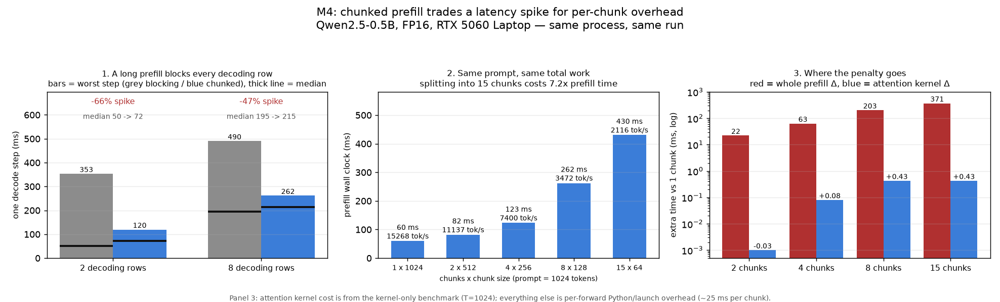

# M4：chunked prefill —— 把"新请求的 prefill"切碎了插进 decode 之间

> 环境：Qwen2.5-0.5B-Instruct · FP16 · RTX 5060 Laptop (sm_120, 26 SM, 8 GB) · Ubuntu 26.04 (WSL2) · torch 2.11.0+cu128 · Triton 3.6.0
> 所有数字都在同一次运行内配对测量；跨运行只比比值，不比毫秒。

## TL;DR

1. **整条 prefill 会把 decode 卡出一个尖峰**：2 行时单步从 50.4 ms 跳到 **353.2 ms**（7×）；8 行时 195.2 → **490.3 ms**（2.5×）。
2. **切成 256 token 一块插进去，尖峰降到 119.6 / 261.6 ms**（降 66% / 47%），代价是每步中位数涨 42% / 10%。
3. **切块的真实代价不是算力，是"每块一次完整的前向"**：端到端 prefill 1024 token，1 块 59.7 ms → 8 块 262.4 ms（4.4×）；而 attention kernel 本身只从 0.363 ms 涨到 0.790 ms（2.2×，绝对值差 0.43 ms）。**99.8% 的代价在 Python/launch 固定开销上，不在 kernel 里。**
4. **chunked prefill 是一场交换，不是优化**：老请求的 ITL 尾部（尖峰）↔ 新请求的 TTFT（从 0 步变成 7 步）。说它"免费"就是漏了后一半。
5. 正确性：分页池上的 chunked prefill 与 HF 整条 prefill **token 逐位一致**，块大小 1024/512/256/128/64 全绿。



*左：长 prefill 插进来时单步延迟的尖峰与中位数；中：同一个 1024-token prompt 切成 1/2/4/8/15 块的端到端 prefill 时间；右：切块的额外时间几乎全在"每块一次完整前向"上，attention kernel 只占千分之一量级。*

## 1. 要回答的三个问题

- 一个长 prefill 插进来，正在 decode 的请求会被卡多久？（M4a）
- 切成块能削掉多少尖峰？代价是什么？（M4a）
- 如果把 prefill 也放进 M3 的分页池（不是 HF 的 dense cache），还能保持正确吗？代价是多少？（M4b/M4c）

## 2. M4a：阻塞 vs 切块（dense DynamicCache，eager）

脚本 `m4a_mixed.py`。`--rows` 条短请求先 decode，第 4 步来 1 条 2048 token 的长请求：

- `blocking`：整条 prefill 一次做完，再继续 decode；
- `chunked`：每步只吃 256 token，吃 8 步。

| 短请求数 | 模式 | 中位数 ms | p95 ms | 尖峰 ms | 总墙钟 ms | 长请求 TTFT |
|---|---|---|---|---|---|---|
| 2 | blocking | 50.4 | 79.3 | **353.2** | 1632 | 0 步 |
| 2 | chunked | 71.5 | 87.2 | **119.6** | 1577 | 7 步 |
| 8 | blocking | 195.2 | 222.6 | **490.3** | 5073 | 0 步 |
| 8 | chunked | 214.6 | 240.0 | **261.6** | 5087 | 7 步 |

三条读数：

- **尖峰降 66% / 47%**，但中位数涨 42% / 10% —— 切块不是免费的，它把成本摊到每一步上。
- **总墙钟几乎不动**（−3% / +0.3%）：切块不改变总工作量，只改变它在时间轴上的形状。
- **TTFT 从 0 步变 7 步**：长请求要等 8 个块，每块之间还要给其他请求让一次 decode。这一项最容易被漏掉。

两处独立反推的 prefill 成本一致（`490.3 − 195.2 = 295 ms`，`353.2 − 50.4 = 303 ms`），所以 2048 token 的整条 prefill 约 **300 ms**（≈6.8 K tok/s）。这个数低于 512 token 时的 75 TFLOPS，原因是 attention 随长度变 O(L²) 且 eager 路径没有 flash 调度——**不是 GPU 变慢了**。

## 3. M4b：q_len > 1 的分页 attention kernel

M3 的 kernel 只能 decode（`q_len = 1`）。chunked prefill 要一次喂 T 个 token 进同一个池子，所以写了第二个 kernel（`m4b_paged_prefill.py`）：

- flash 风格的 online softmax：`m_i / l_i / acc` 三个累加器，每扫一个 K/V 块更新一次，寄存器占用与序列长度无关；
- 双重 mask：因果（`kp <= start + t`）**与**行内有效长度（`kp <= length - 1`）；
- GQA 映射 `kvh = h * HKV // HQ`，不物化 KV（对比：`repeat_interleave` 会把 KV 放大 `hq/hkv = 7` 倍）。

**验收（先证明工具是对的）**：`_harness_selftest()` 在极小规模（2 行、2 头、T=12、d=16、长度 12/7）上先对比"向量化参考 vs 手写循环"，`rel = 2.505e-04` 通过，然后才拿参考去判 kernel。

| 用例 | 结果 |
|---|---|
| 随机张量 3 行（长度 48/37/20），4 头 2 kv | 最大绝对误差 1.953e-03，**相对 5.184e-04** ✅ |
| kernel-only 分块（T=1024，1 行） | 1 块 0.363 / 2 块 0.334 / 4 块 0.443 / 8 块 0.790 ms |

2 块比 1 块还快，是因为切完后半段的每个 query 只需扫它前面那一半的块——**总 FLOPs 只涨 O(1+1/n)**，所以 8 块那 2.2× 主要是每块的固定开销（约 0.06 ms/块），不是算力。

## 4. M4c：把分页 prefill 接进模型

`m4c_qwen_chunk.py` 把 M3 的 decode kernel 与 M4b 的 prefill kernel 挂在**同一个池子、同一张 block table** 上（这补上了 M3 的已知限制 #1：prefill 当时还走 HF 的 dense cache）：

```
Q/K/V 投影 + RoPE → write_chunk 写整段 KV 进池子 → paged_prefill_triton → o_proj
```

**正确性**（prompt 1024 token，真实文本，decode 8 步）：

| 块大小 | 块数 | prefill ms | prefill tok/s | decode ms/步 | token |
|---|---|---|---|---|---|
| 1024 | 1 | **59.7** | **15268** | 24.69 | 一致 ✅ |
| 512 | 2 | 81.8 | 11137 | 23.12 | 一致 ✅ |
| 256 | 4 | 123.1 | 7400 | 24.07 | 一致 ✅ |
| 128 | 8 | 262.4 | 3472 | 23.27 | 一致 ✅ |
| 64 | 15 | 430.5 | 2116 | 23.05 | 一致 ✅ |

另有长度扫描（265/400/512/768/1024）：**池子里的 layer0 K 与 HF 的 cache 逐位相同（最大绝对误差 = 0）**，logits 相对差 1.0–1.6e-03（与 M3c decode 同一量级，来自不同 kernel 的归约顺序），argmax 全部一致。

**这张表最重要的一行不是 token 一致，而是两个时间列的对比**：端到端 59.7 → 430.5 ms（**+371 ms**），kernel 0.363 → 0.790 ms（**+0.43 ms**）。也就是说：

> **切块 15 片的代价 99.8% 不在 attention kernel，而在"每片都要完整跑一次 24 层前向"的固定开销上。**

按 25 ms/块估（`(430.5 − 59.7)/15 ≈ 24.7`），这与前面测过的"一次前向有约 17 ms 的 Python 开销"是同源的。含义很直接：**真正的 chunked prefill 实现必须让每块都能被 CUDA Graph 重放**，否则块切得越细越亏。

## 5. 结论

1. **阻塞式 prefill 的尖峰是真实的、量级在 2.5–7×**；切块能削掉一半以上。
2. **切块的代价分两块**：可预期的一块是每块一次前向的固定开销（本实现约 25 ms/块，占绝对主导）；不可忽略的一块是新请求 TTFT 从 0 变 #块数。
3. **分页池和 chunked prefill 可以共用一套缓存**（这是 M3 没做到的部分），且 token 逐位一致。
4. 要把 chunked prefill 变成"免费"，需要两件事：**每块尺寸的图都能捕获**（否则 25 ms/块吃光收益）和**块间不插 decode**（否则 TTFT 变成 #块数 × ITL）。

## 6. 已知限制

1. M4a 用的是 dense DynamicCache + eager，绝对值被 Python 开销主导；只有组内比值有意义。
2. M4a 只有 1 条长请求、固定第 4 步到达；真实负载里会有多条长请求互相排队，这里没测。
3. M4c 的分块仍是**单条请求**（rows = 1），多行同时 chunked prefill 没实现。
4. M4c 的 decode 仍走 eager（约 23 ms/步）；M3d 的 6.9 ms/步 那张图只对 decode 生效，**分块 prefill 每条块大小需要各自一张图**，本轮没做。
5. `m4a` 反推的 2048-token prefill ≈300 ms 与 M4c 直接测的 1024-token 59.7 ms 不能直接换算（长度不同、并发状态不同），我没有强行让它们一致。
6. block table 仍是静态预分配（每行独占一段连续块），不是真正的按需分配器。

## 7. 复现

```bash
# M4a：阻塞 vs 切块（dense）
bash run_m4a.sh

# M4b：q_len>1 的 kernel 正确性 + kernel-only 分块曲线
bash run_m4b.sh

# M4c：分页 chunked prefill 接进 Qwen（正确性 + 端到端分块曲线）
bash run_m4c.sh
```
