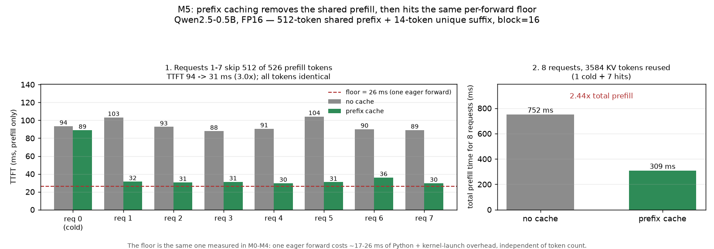

# M5：prefix caching —— 复用共享前缀的 KV 块

> 环境：Qwen2.5-0.5B-Instruct · FP16 · RTX 5060 Laptop (sm_120, 26 SM, 8 GB) · Ubuntu 26.04 (WSL2) · torch 2.11.0+cu128 · Triton 3.6.0
> 全部数字同一次运行内配对测量。

## TL;DR

1. 8 条请求共享同一条 **512 token 系统提示**、各自 14 token 尾巴：命中后 TTFT **94 → 31 ms（3.0×）**，8 条请求的总 prefill **752 → 309 ms（2.44×）**，逐条 **token 全部逐位一致**。
2. 冷请求（第 0 条，缓存还空）**几乎没有收益**（93.5 → 89.0 ms，5%），这正是应有的结果——它必须先把 512 token 算出来。
3. 命中后的 30 ms 不是"还剩一点 prefill"，而是**一次 eager 前向的固定开销**（约 26 ms）。也就是说：512 token 的 prefill 工作量已经被完全消掉，剩下的全是 Python dispatch + kernel launch。
4. 因此 prefix caching 的收益上限不取决于缓存算法，而取决于**你能不能把每次前向的固定成本降下去**（M0d/M3d 的 CUDA Graph 那 3.1–3.7×）。这是整个 P5 反复出现的同一条地板。



## 1. 为什么值得做

`m2a` 已经量过一次：24 次独立 prefill 占了 2206 ms 墙钟里的 981 ms，**每一次都要重读 942 MB 权重**。而真实服务里大量请求共享同一段系统提示（system prompt、few-shot 示例、RAG 的固定指令），这段前缀的 KV 完全一样。

所以这里要回答的不是"能不能缓存"，而是：

- 缓存粒度怎么定、命中判据是什么？
- 命中之后 prefill 还剩多少成本？
- 正确性上有什么坑是"看起来对、其实会写脏别人数据"的？

## 2. 实现（`m5a_prefix_cache.py`）

### 2.1 块级链式哈希

复用单位是**块**（16 token），不是 token。原因很直接：分页池的 block table 就是按块索引的，按 token 复用等于把块边界打碎。

```python
h = 0
for i in range(n_full_blocks):
    h = hash((h, tuple(toks[i*bs:(i+1)*bs])))   # 链式：把前面的内容也压进哈希
```

链式哈希而不是"块内内容的哈希"，是为了让**位置相关的差异**也能区分开：同一个块出现在不同前缀后面，KV 并不相同（RoPE 与前半段都不同）。

### 2.2 只登记"填满的块"

这是整个 M5 唯一真正危险的地方：

- 一条 526 token 的请求有 33 块，其中最后一块只填了 12 个位置；
- decode 的下一个 token 会写进**这一块的第 13 个位置**；
- 如果这一块被登记成共享块，第二个请求就会把它的 KV 写进同一个块 → **污染第一个请求的解码**。

所以 `commit()` 只登记 `L // bs` 个满块（526 // 16 = 32 个），尾巴块永远私有。命中时也只匹配到块边界（`cached = matched_blocks * bs`）。

### 2.3 命中路径

```
cached = bank.match(ids)                       # 最长命中前缀（块对齐）
row_blocks = [共享块 for 0..cached/bs] + [新分配的私有块 for 剩下]
prefill 只跑 ids[cached:]，起点位置 = cached
请求结束后：把 prompt 里填满的块登记进 bank（refcount +1）
```

`prefill_chunked(..., start_at=cached)` 是这一步的关键：它不是"跳过 dv 部分再重算"，而是**真的只从 `cached` 位置开始算**——因为前缀的 KV 已经躺在共享块里了。

## 3. 正确性

| 检查 | 结果 |
|---|---|
| 8 条请求（缓存开/关）逐条对比 decode 出的 token | **8/8 完全一致** ✅ |
| 冷请求（req 0）开缓存与不开缓存的 TTFT | 89.0 vs 93.5 ms（差 5%，属噪声） |
| 复用的 KV token 数 | 3584（= 7 × 512） |
| 缓存表里的块数 | 32（= 512 / 16） |

## 4. 结果

| # | 无缓存 TTFT | 有缓存 TTFT | 降幅 |
|---|---|---|---|
| 0（冷） | 93.5 ms | 89.0 ms | 5% |
| 1 | 103.3 | **31.5** | 69% |
| 2 | 92.7 | **30.6** | 67% |
| 3 | 87.9 | **31.2** | 65% |
| 4 | 90.6 | **29.7** | 67% |
| 5 | 104.3 | **30.8** | 70% |
| 6 | 90.2 | **36.1** | 60% |
| 7 | 89.2 | **29.7** | 67% |
| **合计** | **751.8 ms** | **308.7 ms** | **2.44×** |

命中请求的 TTFT 平均 **94 → 31 ms（3.0×）**。

### 4.1 那 31 ms 是什么

命中后要 prefill 的只有 14 个 token —— 1 块、1 次前向。按 `chunk=256` 分块它只触发 1 次 forward，而一次 eager forward 的固定开销约 26 ms（M0b 量的 17 ms Python + 4.9 ms launch，加上这轮实测的波动）。也就是说：

> **31 ms ≈ 一次前向的地板，而不是 14 个 token 的计算量**（14 token 的计算量在 µs 级）。

推论很硬：**如果前向固定成本降不下去，prefix caching 的绝对收益就封在"从 94 降到 31"。** 想把命中 TTFT 压到 10 ms 以内，必须让这条路也能被 CUDA Graph 重放（每块尺寸一张图），否则缓存算法再花哨也没用。

## 5. 结论

1. **prefix caching 是"消掉工作量"，不是"加速计算"**：命中时 512 token 的 prefill 真的一点都不算，所以收益是**线性于被复用的前缀长度**的。
2. **收益的绝对上限由前向固定成本决定**：本实现命中 TTFT 30 ms 里，26 ms 是地板、约 2 ms 才是那 14 个 token。这一点在 M0–M4 每一节都以不同形式出现过。
3. **正确性的坑在"半空块"**：登记填满的块、命中只到块边界、尾巴块永远私有。写错一处就是"自己的解码把别人的 KV 覆盖掉"，而且不一定立刻看出来。
4. 冷请求几乎无收益是**正确行为**，不是缓存失效。

## 6. 已知限制

1. **没有淘汰**：bank 只增不减，块池（本实验 56 块）耗尽就报错。真实系统要 LRU + refcount 归零回收。
2. **只复用 prompt 前缀**，不复用"上一轮生成的内容"（多轮对话的收益会更大，但需要 session 级管理）。
3. **只有一行**：并发多行时共享块的 refcount 与释放逻辑没测。
4. **收益是"最优 workload"**：8 条请求共享 512 token 完全相同的前缀。真实流量的命中率取决于前缀重复度，本报告没有测任何真实分布——这一条要写在任何对外表述里。
5. 分块仍按固定 `chunk=256`；命中前缀不是 256 的整数倍时会多切一块。
6. 命中判据是**精确 token 匹配**（链式哈希），不支持"近似前缀"。

## 7. 复现

```bash
bash run_m5a.sh                        # 默认 512 token 前缀、8 条请求
bash plot_m5.sh                        # 重画汇总图
python m5a_prefix_cache.py --prefix 1024 --reqs 8   # 换更长前缀
```
