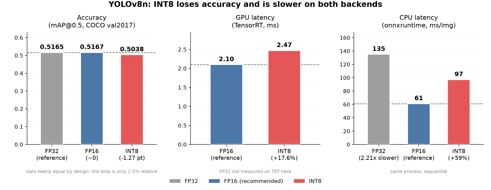

# TensorRT 11 删掉了 calibrator，INT8 该怎么做？

> **以及一个更重要的问题：做完之后，你可能不该用它。**

**环境**：TensorRT 11.4 · CUDA 12.8 · YOLOv8n · RTX 5060 Laptop（sm_120, 26 SM, 8 GB）· Ubuntu 26.04 (WSL2)

> **文中的每一个数字都可以在 30 分钟内复现** —— 数据、脚本、测量方法都在
> <https://github.com/liaozi7828/trt-deploy>。
> 其中包括我**测错过**的几个结论（小样本 mAP、fp16 转换器、评测集口径），
> 以及它们是怎么被发现的。

---

## 0. 先说结论

| 问题 | 答案 |
|---|---|
| calibrator 去哪了 | **删了**。TRT 10 起 INT8 精度由 **ONNX 模型的 dtype** 决定，不再由引擎配置选项决定 |
| 现在该怎么做 | **在 ONNX 里写 QDQ 节点**（`QuantizeLinear` / `DequantizeLinear`），再建引擎 |
| 有什么坑 | 三个，都会**直接建引擎失败**：非对称 zero_point、int32 bias、检测头不可量化 |
| 做完值得用吗 | **看情况**。YOLOv8n 上我实测 **INT8 掉 1.27 pt，而且比 FP16 更慢** —— 见第 5 节 |

**如果你只想知道"为什么我的 calibrator 编译不过"** → 看第 1、2 节。
**如果你在决定"要不要上 INT8"** → 直接跳第 5 节。

---

## 1. TRT 11 到底删了什么，为什么

### 1.1 两条主线

从 TRT 10 到 11 有一堆破坏性变化，回头看它们其实只有**两条主线**。

**主线 A：把"应用负责的生命周期"收回库内部**

| 变化 | 表现 |
|---|---|
| `destroy()` 删除 | 改用 `delete` |
| 参数从指针改引用 | `addPluginV3(..., IPluginV3&)`、`buildSerializedNetwork(net, IBuilderConfig&)` |
| `IExecutionContext::setWorkspace()` 删除 | **应用不再管 workspace**，插件声明需求、TRT 负责分配 |

**主线 B：把"可选的模式"变成"唯一的模式"**

| 变化 | 表现 |
|---|---|
| `BuilderFlag::kFP16` / `kINT8` 删除 | **精度由模型 dtype 决定**（strong typing） |
| **`IInt8Calibrator` 全套删除** | **量化信息必须在 ONNX 里**（QDQ） |
| `NetworkDefinitionCreationFlag::kEXPLICIT_BATCH` 删除 | explicit batch 成为唯一模式，传 `0` |

**所以 calibrator 的删除不是孤立事件** —— 它是"精度不再是引擎的选项"这个方向的一部分。

> **记住这两条，遇到任何"TRT 11 又删了什么"都能先分类，不用逐条背。**

### 1.2 对你的代码的具体影响

```cpp
// ❌ TRT 8 的写法，TRT 11 全部编译不过
config->setFlag(BuilderFlag::kINT8);
config->setFlag(BuilderFlag::kFP16);
ICudaEngine* engine = builder->buildCudaEngine(*network);   // 也没了
IInt8Calibrator* calib = new MyCalibrator(...);             // 类都删了

// ✅ TRT 11：配置里**不声明精度**
auto* config = builder->createBuilderConfig();
config->setMemoryPoolLimit(MemoryPoolType::kWORKSPACE, 1ull << 30);
// 精度怎么定？看 network 里每个张量的 dtype —— 也就是看你喂进来的 ONNX
```

**关键认知转变**：

> **以前：一个 FP32 的 ONNX + 引擎配置里的 flag = 三种精度。**
> **现在：三个不同 dtype 的 ONNX = 三种精度。精度是**模型的一部分**，不是引擎的一部分。**

---

## 2. 正确的做法：ONNX QDQ

### 2.1 为什么必须是 QDQ

TRT 11 从 ONNX 里读到的信息只有"这个张量是什么 dtype"。
要让它做 INT8，模型里必须**显式**写出"这里量化、这里反量化"：

```
浮点张量 --QuantizeLinear--> int8 张量 --(int8 运算)--> int8 张量 --DequantizeLinear--> 浮点张量
```

**这两个节点就是 QDQ。TRT 看到它们，就知道中间那段要用 INT8 kernel，而且已经知道 scale 和 zero_point。**

**不需要 calibrator** —— 因为量化参数已经写死在模型里了。

### 2.2 完整流程

**四步**：

```bash
# ① 导出 FP32 ONNX（照常）
python scripts/export_yolo.py --model yolov8n.pt --out models/yolov8n.onnx

# ② 准备校准集（几十张代表性图片就够）
python scripts/prepare_calib.py --data ~/datasets/coco128/images --n 100 --out calib/

# ③ 插入 QDQ（核心）
python scripts/quantize_int8.py \
    --model models/yolov8n.onnx \
    --calib calib/ \
    --out models/yolov8n_int8.onnx

# ④ 建引擎（不再需要任何 INT8 flag）
trtexec --onnx=models/yolov8n_int8.onnx --saveEngine=models/yolov8n_int8.engine
```

**第 ③ 步用的是 onnxruntime 的量化工具**：

```python
from onnxruntime.quantization import (
    quantize_static, CalibrationDataReader, QuantFormat, QuantType,
)

quantize_static(
    model_input=src,
    model_output=dst,
    calibration_data_reader=reader,
    quant_format=QuantFormat.QDQ,          # ★ 关键：QDQ 格式，不是 QOperator
    activation_type=QuantType.QInt8,
    weight_type=QuantType.QInt8,
    per_channel=True,
)
```

> **`QuantFormat.QDQ` 是重点。** 默认的 `QOperator` 会把量化"藏"在算子属性里（`QuantizeLinear` 变成 `DynamicQuantizeLinear` 之类），
> **TRT 认不出来 → 引擎建成功但**根本没加速**（悄悄退回 FP32）**。这是最容易踩的一个"静默失败"。

### 2.3 QDQ 节点长什么样

插完之后模型里会出现大量这样的结构：

```
/model.0/conv/Conv_output_0
   ├─ QuantizeLinear(scale=0.0123, zero_point=0)  → int8
   │     └─ ... 下一层的 int8 输入 ...
   └─ DequantizeLinear(scale=0.0123, zero_point=0) → float
```

**检查方法**：

```python
import onnx
m = onnx.load("models/yolov8n_int8.onnx")
ops = {}
for n in m.graph.node:
    ops[n.op_type] = ops.get(n.op_type, 0) + 1
print({k: v for k, v in ops.items() if "Quant" in k})
# 期望: {'QuantizeLinear': 250+, 'DequantizeLinear': 250+}
```

**如果 `QuantizeLinear` 只有个位数** → 说明量化没生效，别往下走。

---

## 3. 三个必踩的坑

这三个我都撞过，**报错各不相同，但结果都是"建引擎失败"**。

### 3.1 坑一：非对称 zero_point

**报错**：

```
[TRT] [E] ... QuantizeLinear with asymmetric zero point is not supported
```

**原因**：ONNX 的 `QuantizeLinear` 允许 `uint8` + 任意 `zero_point`（非对称量化）。
**TRT 只支持对称量化**（`int8`，zero_point 恒为 0）。

**修法**：量化时强制对称。

```python
# ✅ 用 QInt8（有符号）+ zero_point=0
activation_type=QuantType.QInt8,       # 不是 QUInt8
weight_type=QuantType.QInt8,
```

**检查**：遍历所有 `QuantizeLinear`，确认 `zero_point` 全零。

```python
import numpy as np, onnx
from onnx import numpy_helper

m = onnx.load("models/yolov8n_int8.onnx")
init = {i.name: numpy_helper.to_array(i) for i in m.graph.initializer}
bad = []
for n in m.graph.node:
    if n.op_type == "QuantizeLinear" and len(n.input) >= 3:
        zp = init.get(n.input[2])
        if zp is not None and not np.all(zp == 0):
            bad.append((n.name, zp))
print(f"非对称的 QuantizeLinear: {len(bad)} 个")
for name, zp in bad[:5]:
    print(f"  {name}: zero_point={zp}")
```

**如果 `bad` 不为空 → 引擎一定建不出来。**

### 3.2 坑二：int32 量化 bias

**报错**：

```
[TRT] [E] ... unexpected data type Int32 for input of layer ...
```

**原因**：ONNX QDQ 规范里，Conv 的 bias 会被量化成 **int32**（因为 int32 累加不溢出）。
**但 TRT 的卷积层不接受 int32 的 bias 输入。**

**修法**：把 bias 的 QDQ 拆掉，让它保持浮点。

```python
from onnx import helper

def unquantize_bias(model):
    """把 Conv 的 int32 bias 换回 float32"""
    keep = []
    bias_names = set()
    for n in model.graph.node:
        if n.op_type in ("Conv", "ConvTranspose", "Gemm"):
            if len(n.input) >= 3 and n.input[2]:
                bias_names.add(n.input[2])
    for n in model.graph.node:
        if n.op_type == "DequantizeLinear" and n.output[0] in bias_names:
            continue                      # 丢掉 bias 的反量化
        keep.append(n)
    del model.graph.node[:]
    model.graph.node.extend(keep)
    return model
```

**更省事的做法**：直接告诉量化工具别量化 bias（`onnxruntime` 的 `extra_options`）：

```python
extra_options={"ActivationSymmetric": True, "WeightSymmetric": True}
```

### 3.3 坑三：检测头不可量化

**这个最阴 —— 它不一定报错，可能只是"精度崩了"。**

YOLO 的输出是 `[1, 84, 8400]`，其中 8400 个格子的 `(cx, cy, w, h)` 是在 **stride 换算**之后得到的：
`(grid_x + sigmoid(tx)) * stride`。

**`stride`、`anchor`、`grid` 这些常量一旦被量化成 int8，坐标会整体漂移几十个像素** —— 表现为"能跑、框数也对、但 mAP 掉到接近 0"。

**修法**：把检测头（最后几层 1×1 conv）排除在量化之外。

```python
# 按节点名白名单排除
nodes_to_exclude = [
    "/model.22/Concat_1",      # 检测头的 concat
    "/model.22/Conv_1", "/model.22/Conv_2", "/model.22/Conv_3",   # cls/reg 分支
]

quantize_static(
    ...,
    nodes_to_exclude=nodes_to_exclude,   # ★
)
```

**怎么找这些名字**：

```python
import onnx
m = onnx.load("models/yolov8n.onnx")
for n in m.graph.node:
    if "model.22" in n.name:            # YOLOv8 的 head 在 model.22
        print(n.op_type, n.name)
```

**验证量化有没有生效的判据**（重要，不靠猜）：

```python
# 插 QDQ 后，head 附近的张量 dtype 应该还是 float
import onnx
m = onnx.load("models/yolov8n_int8.onnx")
for t in m.graph.value_info:
    if "model.22" in t.name and "output" in t.name:
        print(t.name, t.type.tensor_type.elem_type)
        # 1=float32, 3=int8
```

---

## 4. 实测：精度和性能

**模型**：YOLOv8n（3.2 M 参数，8.1 MB FP32）
**数据集**：COCO val2017 **完整 5000 张**，指标用 **pycocotools 官方协议**

### 4.1 精度

| 档位 | mAP@0.5:0.95 | mAP@0.5 | mAP@0.75 | 检出框数 |
|---|---|---|---|---|
| FP32 | **0.3668** | **0.5165** | 0.3987 | 857,548 |
| FP16 | 0.3669 | 0.5167 | 0.3988 | 858,817 |
| **INT8** | **0.3552** | **0.5038** | 0.3870 | **949,474** |
| 相对 FP32 | **−1.16 pt** | **−1.27 pt** | −1.17 pt | **+10.7%** |

**校验点**：官方 YOLOv8n 在 COCO val2017 的 mAP@0.5:0.95 = **0.373**，
我们 FP32 测出 **0.3668**，差 **0.6 pt（1.7%）** —— **说明整条流水线是对的。**

> **这一步很关键。如果你测出的 FP32 和官方差很多，别急着调 INT8 —— 先确认自己的评测链路。**

### 4.2 性能：**INT8 反而更慢**



> **左栏三根柱子几乎等高是对的，不是图画歪了** —— INT8 相对掉了 **2.5%**，在这个坐标尺度上本来就看不出来。
> 我本可以截断 y 轴把它放大成"肉眼可见的差距"，但那是柱状图最常见的误导手段之一，
> 而这篇东西的卖点恰恰是数字可信，所以不这么做。
>
> **决策依据是中间和右边两栏**：两个后端上 INT8 都比 FP16 慢（GPU +17.6%、CPU +59%）。
>
> 绘图脚本：仓库里的 `blog/plot_int8_tradeoff.py`（数据只有 8 个数字，都在文件头部）。

**GPU（TensorRT 11，同样用 CUDA Graph）**：

| 档位 | 延迟 | 相对 FP16 |
|---|---|---|
| FP16 | 2.10 ms | — |
| **INT8** | **2.47 ms** | **慢 17.6%** |

**CPU（onnxruntime，单进程依次跑，排除跨运行漂移）**：

| 档位 | 每张推理耗时 | 相对 FP16 |
|---|---|---|
| FP32 | 135 ms | 慢 2.21× |
| **FP16** | **61 ms** | — |
| **INT8** | **97 ms** | **慢 59%** |

**两个完全不同的后端、不同的量化实现、不同的访存层次，都是 INT8 更慢。**

### 4.3 掉点从哪来：不是定位变差，是**低分误检变多**

注意上表那个 **框数 +10.7%** —— 三个模型的 `conf` 阈值都是 `0.001`，所以 INT8 **凭空空出了 9 万个低分框**。

**进一步证据**：

```
mAP@0.5  掉 1.27 pt
mAP@0.75 掉 1.17 pt      ← 更严格的阈值，反而掉得更少
```

**如果是"框画得不准"，更严格的 IoU 阈值应该掉得更多。实际相反 → 是"多出来的低分框拉低了 precision"。**

**机理**：量化给分数引入了噪声，把一批本该低于阈值的背景框推过了线。这些框绝大多数是 FP。

> **推论（未验证）**：实际部署用 `conf=0.25` 时，这个掉点可能观察不到。
> 要验证需要在几个 `conf` 阈值上各测一次掉点曲线。**我没做，所以不当结论。**

---

## 5. 所以你该不该上 INT8

**我的判据是三个问题，按顺序问**：

### 问题一：你现在是**算力受限**还是**访存/派发受限**？

```
算力受限（大 batch、大模型、计算量大）→ INT8 有戏
访存受限（小模型、batch=1、GPU 用不满）→ INT8 收益很小
```

**怎么判断**：算有效带宽。

```
有效带宽 = 权重字节数 ÷ 单次推理耗时

YOLOv8n FP16:   8.1 MB ÷ 2.10 ms ≈ 3.9 GB/s
RTX 5060 峰值:  约 384 GB/s
→ 只跑到 1%
```

**一整个模型算一次，连带宽的 1% 都没用到 —— 这说明瓶颈根本不是"搬数据慢"。**

**真正的瓶颈是每次推理固定的一次派发开销。证据**：加 CUDA Graph 把几百次 kernel 启动合成一次重放后，
延迟从 **2.01 → 0.63 ms**，**省下的 1.38 ms 就是纯派发开销**，与模型大小无关。

> **这种情况下，把权重从 FP16 压到 INT8，省下的那点字节在总时间里看不见 —— 而那 1.4 ms 一分不少。**
> **这就是"INT8 在 YOLOv8n 上没有价值区间"的根本原因。**

### 问题二：掉点你**能不能接受**？

**判据不要用"掉几个点"，要用"掉点是否影响下游决策"。**

我测的 YOLOv8n 是 −1.27 pt。这个数字本身不能判断好坏，**要看你的场景**：

- 如果只是"看见人"，−1.27 pt 可能完全看不出来
- 如果是"数人头"或"测距"，尾部误差会放大

**最低限度：自己测一次，别抄别人的数字。**

### 问题三：掉点**来源**你搞清楚了吗？

用**分组消融**定位敏感区（我的实测）：

| 量化范围 | mAP@0.5 | 掉点 |
|---|---|---|
| 只量化 backbone | 0.5654 | **−2.53 pt** |
| 只量化 neck | 0.5907 | **0 pt** |
| 全量化 | 0.5731 | −1.76 pt |

**结论：敏感区在 backbone，neck 完全无损。**

> **这个信息比"总掉点"有用得多** —— 它告诉你"如果把 backbone 保 FP16、只量化 neck，可能一分不掉"。
> （我没试这个组合，但那是下一步该做的实验。）

### 我的结论（YOLOv8n 上）

> **INT8 没有价值区间**：掉 1.27 pt，而且在两个后端上都比 FP16 慢。
> **直接用 FP16** —— 它几乎无损（0.5165 → 0.5167），还快 2.21×（CPU）。
>
> **换成 ResNet50/7B 那种真正算力受限的模型，结论可能完全相反。**
> **所以这篇的重点不是"INT8 没用"，而是"怎么判断它在你的模型上有没有用"。**

---

## 6. 顺带两个"静默错误"

这两个坑不属于 INT8 本身，但**都会让你得到一个看起来很合理的错误结论**。

### 6.1 用 128 张图测 mAP，会系统性夸大差异

| 量 | 128 张 | 500 张 | 5000 张 |
|---|---|---|---|
| 同一模型 mAP@0.5 | — | 0.4000 | **0.3668** |
| INT8 掉点 | −1.76 pt | — | **−1.27 pt** |

**小数据集不是"噪声大"，是**偏向乐观**：绝对 mAP 高估 3.3 pt，掉点高估 0.5 pt。**

> **所以网上那些"INT8 只掉 0.3 pt"的结论，先看它是在多少张图上测的。**

### 6.2 换个精度的脚本，可能"成功"地写了个假文件

我在做 FP16 转换时踩到：脚本依次试三个转换后端，最后一个 `none`（不转换）"成功"了 ——
**于是它把 FP32 模型写进了 `yolov8n_fp16.onnx`。**

| 现象 | 看起来 | 真相 |
|---|---|---|
| 加载成功 | 转换成功 | 加载的是 fp32 |
| mAP 和 FP32 一模一样 | **FP16 零掉点，太好了** | 压根没测 FP16 |
| 文件 12.3 MB | 没注意 | **fp32 是 12.3 MB，fp16 是 6.2 MB** |

**防线**：**一个跟正确性无关、但一眼能看穿的旁证 —— 文件体积比。**

```python
if dst_size / src_size > 0.85:
    print("[WARN] 体积比太接近 1，这不像真的转成了 fp16")
```

> **这类错误的共同点是：它不报错、结果合理、符合预期。**
> **所以你必须在每一步找一个**独立的旁证**去验它，而不是"改完就该对"。**

---

## 7. 复现

> **完整代码**：<https://github.com/liaozi7828/trt-deploy>
> —— 三个项目的实现、四份技术报告（合计约 3000 行）、以及所有测量脚本。
> 本文涉及的量化、评测、plugin 代码都在 `02-yolov8-trt/` 下，
> 每个数字都能按对应 README 里的命令复算。

**环境**：TensorRT 11.4、CUDA 12.8、onnxruntime 1.31、RTX 5060 Laptop

```bash
# 依赖
pip install onnx onnxruntime pycocotools opencv-python ultralytics

# 数据（COCO val2017：图片 778 MB + 标注 20 MB）
wget http://images.cocodataset.org/zips/val2017.zip
wget http://images.cocodataset.org/annotations/annotations_trainval2017.zip
unzip val2017.zip -d coco/ && unzip annotations_trainval2017.zip annotations/instances_val2017.json
mv annotations coco/

# 量化
python scripts/prepare_calib.py --data coco/val2017 --n 100 --out calib/
python scripts/quantize_int8.py --model models/yolov8n.onnx --calib calib/ \
    --out models/yolov8n_int8.onnx

# 评测（5000 张，pycocotools 官方协议）
python scripts/eval_map_coco.py --data coco/ \
    --models models/yolov8n.onnx models/yolov8n_fp16.onnx models/yolov8n_int8.onnx
```

**注意 `--data` 指向的目录结构**：

```
coco/
├── val2017/                          5000 张
└── annotations/instances_val2017.json   20 MB
```

---

## 8. 一句话

> **TRT 11 删掉 calibrator 不是"变麻烦了"，而是把精度从"引擎的选项"变成了"模型的属性"** ——
> **短期看你要重写代码，长期看这是对的：同一个 ONNX 在任何地方跑，精度行为都是一致的。**

> **而 INT8 该不该用，答案不在任何一篇博客里（包括这篇）** ——
> **它取决于你的模型是算力受限还是派发受限。而这个，只能自己测。**
